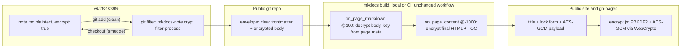

# 3.5.0 Page Encryption

## Context

The user wants selected notes in an **open-source** notes repo to be readable on the published site only after entering a password. Target environment: `~/vg101/vglab/docs/wiki` (git submodule; edit on `obsidian`, `just sync` merges into `main`; CI `pip install -r requirements.txt` + `mkdocs gh-deploy --force` to a public `gh-pages` branch; `navigation.instant` off).

**What the reference really does** (inspected 2026-11-06): no encryption. The public stub hashes `sha256("static-site-encryption" + password)` and redirects to a hidden page `/s/<hash>/`, and that hidden URL is listed in the site's public `sitemap.xml`. In an open repo that model leaks completely (plaintext source in git, hidden page in the public `gh-pages` branch). This release therefore implements real encryption: ciphertext in git, ciphertext on the site, decryption in the browser.

**Decisions locked with the user:**

1. Opt-in per note: frontmatter `encrypt: true`. Default is no encryption.
2. Password = frontmatter `password` if non-empty, otherwise `permalink` (must then be non-empty). Both stay **in plain text in the committed frontmatter**. Accepted trade-off: in an open repo this deters site visitors, search engines and crawlers, not people who read the repo; in a private repo the permalink is not public, so it is real secrecy.
3. At rest: a **git clean/smudge filter**. The working tree stays plaintext (Obsidian/VS Code edit normally); committed blobs are encrypted envelopes.
4. **No extra configuration**: no passwords in `mkdocs.yml`, no secrets file, no GitHub Secrets, no change to the wiki's deploy workflow. CI decrypts envelopes with the password from the clear frontmatter, renders normally, and re-encrypts the page for the browser.
5. Encrypted notes keep their **title** in nav, recent notes and the graph. The graph keeps the node and edges pointing to it, but drops its outgoing edges.
6. **Notion sync is deprecated as of 3.5.0.** It still works but prints a deprecation notice, and removal is planned for 4.0.0 (removing a feature is a SemVer-major change). As a safety measure, the deprecated command skips encrypted notes.

Release: **3.5.0** (new feature, SemVer minor). Step 0 after approval: save this plan as `.claude/plans/3.5.0_page_encryption_7c1e9b42.plan.md` and add its row to `.claude/skills/project-plans/SKILL.md`.

## Architecture



Locally the working tree is already plaintext, so the decrypt step is a no-op; one code path serves `mkdocs serve`, local builds and CI.

## Frontmatter and password rules

```yaml
---
title: 11408考研复习规划
date: 2026-11-06 09:02:00
permalink: 11408-resource   # default password
publish: true
encrypt: true               # opt-in
# password: "custom secret" # optional, overrides permalink
---
```

- `encrypt` truthy → password = `password` if present and non-empty, else `permalink`. Neither → error (the clean filter refuses the `git add`; the build raises `PluginError`).
- Normalize identically in Python and JS: `str(value)` → Unicode NFC → strip surrounding whitespace. If YAML produced a non-string (`permalink: 1e3`, `password: yes`), warn and ask the user to quote the value.
- Field names are fixed (like the existing `publish`, `preview`, `permalink` fields) and documented in `docs/usage/meta.md`.
- Envelopes support YAML (`---`) frontmatter only.

## At-rest envelope (committed blob)

```markdown
---
<original frontmatter block, verbatim>
---

> 🔒 This note is encrypted by mkdocs-note. Read it on the published site.

<!-- mkdocs-note:encrypted v1 key=permalink
<standard base64 of nonce|ciphertext|tag, wrapped at 76 columns>
-->
```

- Only the body is encrypted. The frontmatter stays readable, so the scanner (`on_files` @100), MkDocs `page.meta`, git diffs and GitHub's frontmatter table work without a key, and frontmatter edits diff readably.
- Split with MkDocs' own `YAML_RE` (`mkdocs.utils.meta`) so boundaries match MkDocs. Keep the body verbatim for a byte-exact smudge. (`utils/meta.parse_frontmatter` is lossy: it strips leading newlines.)
- Deterministic: the same plaintext always yields a byte-identical envelope, so `git status` stays stable. The format is fixed per version (`v1`, wrap 76, LF, trailing newline).
- Clean normalizes CRLF→LF and drops a BOM **only for flagged notes**. Non-flagged files pass through byte-for-byte, including CRLF, BOM and invalid UTF-8. Envelopes pass through clean unchanged (idempotent).
- Smudge accepts CRLF-converted envelopes (git converts line endings before smudge) and never fails a checkout. An undecryptable envelope is output unchanged with one stderr warning.

## Crypto

`cryptography` becomes a runtime dependency (AES-GCM, HKDF). Everything else is stdlib (`hashlib.pbkdf2_hmac`, `hmac`, `base64`).

| Layer | Key | Cipher |
|---|---|---|
| At rest (git) | `HKDF-SHA256(pw, salt="mkdocs-note/v1/at-rest")`. Fast on purpose: the password sits in the same file, so a slow KDF would add cost and no security. | AES-256-GCM with synthetic nonce `HMAC-SHA256(K_nonce, aad ‖ 0x00 ‖ body)[:12]`; AAD `mkdocs-note:v1:<key-field>`. Path-independent, so `git mv` keeps working. |
| Site (browser) | `PBKDF2-HMAC-SHA256(pw, salt=SHA-256("mkdocs-note:v1:site:" + src_uri)[:16], 600000)`. WebCrypto-native; the slow KDF matters when a private repo publishes a public site. A stable salt keeps remembered keys valid across deploys. | AES-256-GCM with the same synthetic-nonce construction (reproducible builds); plaintext = UTF-8 JSON `{"v":1,"content":…,"toc":…}` |

Memoize PBKDF2 per process with a module-level `functools.lru_cache` keyed on (pw, salt, iterations). `mkdocs serve` rebuilds then skip re-deriving 600k iterations.

## Build integration (`src/mkdocs_note/plugin.py`)

- **`on_page_markdown`** becomes a `mkdocs.plugins.CombinedEvent`:
  - New `_on_page_markdown_decrypt`, `@event_priority(100)`, runs before other plugins. If `page.markdown` is an envelope, it decrypts it with the password from `page.meta`, which MkDocs already parsed from the clear frontmatter.
  - The existing recent-notes handler keeps its default priority.
  - Why not `on_page_read_source`: it is deprecated in MkDocs 1.6, and setting `File.content_string` nulls `abs_src_path`, which breaks the scanner, graph, preview and git-revision-date.
- **`on_page_content`**, `@event_priority(-1000)`, runs after all plugins and the user's `hooks:` (e.g. the wiki's fancybox `` wrapper). For an encrypted page:
  - Build the payload from the final HTML. Prepend `<h1>{title}</h1>` when the HTML has none, mirroring Material's auto-h1.
  - Add a Material-markup TOC rendered from `page.toc`.
  - Return the stub, then set `page.toc` to an empty `TableOfContents` so Material search and the TOC sidebar receive nothing.
- **Stub:** `<div class="mkdocs-note-encrypted"><h1>{title}</h1>` + lock form with labels + `<noscript>` + `<script type="application/json" class="mkdocs-note-encrypted__payload">{v, iter, salt, iv, ct}</script></div>`. The `<h1>` keeps Material from adding its own.
- **`on_post_page`:** inject `css/encrypt.css` and `js/encrypt.js` into encrypted pages only. The URL comes from `mkdocs.utils.get_relative_url`.
- **`on_post_build`:** copy both assets when any page was encrypted (same pattern as `copy_preview_static_assets`), then run the leak audit.

## Browser runtime (`src/mkdocs_note/static/encrypt.js`, `encrypt.css`)

Classic IIFE in the `preview.js` style. Boot through `document$.subscribe`, otherwise `DOMContentLoaded`.

1. Find stubs and parse the payload. If `isSecureContext` or `crypto.subtle` is missing, show `labels.unsupported` (WebCrypto needs HTTPS or localhost).
2. Try the remembered key. Storage is `sessionStorage` by default, or `localStorage`/none per config, under key `mkdocs-note:encrypt:<salt>`. Wrap every storage access in try/catch.
3. On submit: NFC + trim → PBKDF2 → AES-GCM decrypt. On failure, show `labels.error` in an `aria-live` region.
4. On success:
   - Replace the stub with the decrypted HTML.
   - Inject the TOC into `.md-sidebar--secondary .md-nav--secondary` when it is present and empty.
   - Scroll to the `decodeURIComponent(location.hash)` target (non-ASCII ids, per the 3.4.2 lesson).
5. If `rerender` is on and `window.document$` exists, call `document$.next(document)`. This re-mounts Material components (code copy, tabs, tooltips, mermaid) and re-runs user subscribers such as the wiki's `mathjax.js` and `links.js`. Always dispatch `CustomEvent("mkdocs-note:decrypted", {detail: {element}})`. mkdocs-note's own `preview.js` re-binds idempotently (same listener references) and `graph.js` clears its container before re-rendering.

## Config (`encryption_config`, optional — the per-note flag is the opt-in)

```yaml
plugins:
  - mkdocs-note:
      encryption_config:
        kdf_iterations: 600000
        remember: session   # session | local | none
        strict: auto        # auto = on when env CI is truthy | true | false
        rerender: true      # document$.next(document) after decryption
        audit: true         # post-build plaintext leak audit (warnings)
        labels:             # UI strings, English defaults
          title: Encrypted note
          prompt: This note is encrypted. Enter the password to read it.
          placeholder: Password
          submit: Unlock
          error: Incorrect password.
          unsupported: Decryption needs a modern browser over HTTPS.
          noscript: JavaScript is required to read this note.
          toc: Table of contents
```

Declared as `config_opt.Type(dict)` like `preview_config`. Keep one defaults dict and read values with `.get(key, default)`, because `Type(dict)` does not merge nested defaults.

## Git filter and CLI (`mkdocs-note crypt …`)

| Command | Purpose |
|---|---|
| `crypt init` | Per clone, idempotent. See the steps below. |
| `crypt status` | For each flagged note: key field and worktree / index / HEAD state (envelope, PLAINTEXT, corrupt). Also reports whether the filter, hook and attribute are present. Exits non-zero on problems. |
| `crypt check --staged` | Hook body. Staged flagged notes must be valid, decryptable envelopes (catches `git add -p` corruption and missing filters). A note flagged in the worktree must not be staged as plaintext. |
| `crypt uninstall` | Removes the git config and our hook. Run it before downgrading the plugin or deleting the venv. |
| `crypt filter-process` (hidden) | Git long-running process protocol v2: pkt-line, `clean` + `smudge` capabilities. stdout carries binary protocol data only; logs go to stderr. |
| `crypt clean PATH` / `crypt smudge PATH` (hidden) | Single-shot stdin→stdout fallbacks; also useful for manual inspection. |

`crypt init` steps:

1. Set the git config:
   - `filter.mkdocs-note.process`
   - `filter.mkdocs-note.required=true`
   - `clean`/`smudge` fallbacks

   Each command is `"<sys.executable>" -m mkdocs_note crypt …`, written with forward slashes and quoted so it works on Windows.
2. Add `/<docs_dir>/**/*.md filter=mkdocs-note` to `.gitattributes`. The path is repo-relative, and the user commits the file.
3. Install a POSIX `pre-commit` hook at `git rev-parse --git-path hooks`. If a hook already exists, print the line to add instead.
4. Refuse if `sys.executable` is an ephemeral `uvx` environment.
5. List flagged notes whose index copy is plaintext, with the `git add` to run.

It must work inside submodules: use `rev-parse --git-path` / `--git-common-dir`.

Supporting changes: add `src/mkdocs_note/__main__.py` so `python -m mkdocs_note` works. Register the `crypt` subgroup in `cli.py` and make `CustomGroup.format_commands` list it. Add the commands to `tests/test_help.py`.

## Leak channels

| Channel | Handling |
|---|---|
| Page HTML, `<title>`, nav | Stub + ciphertext only. The title stays public by design. |
| Material search index | Sees only the stub; `page.toc` is cleared before `on_page_context`. |
| `previews.json` | Skip encrypted pages in `PreviewBuilder._add_page` (next to the `preview: false` check, preview.py ~799). Also skip them as link sources in `_collect_from_file` (~757). |
| `graph.json` | Keep the node (the title is public). Skip out-edges of encrypted notes in `Graph._create_edges` (graph.py:89-97). |
| Recent notes | Unchanged (title and date only). |
| Notion sync (CLI, deprecated) | Safety skip: drop encrypted notes in `collect_targets` (sync.py:880-928), before `sync_one_page` creates the page. Log them as skipped. |
| Material blog posts / RSS | Refuse `encrypt` on blog posts with a `PluginError`; their excerpts and RSS entries would leak. |
| `<meta name="description">`, tags | Frontmatter is public by design; documented. |
| Images and other assets | Not encrypted; documented. |

## Notion sync deprecation (3.5.0)

- **CLI:** mark `notion-sync` / `ns` with click's `deprecated=…` message. The notice prints on every run and in `--help`; behavior and exit codes are unchanged.
- **Plugin:** if `notion_sync` is present in the plugin config, log one notice per build at INFO level, not WARNING, so `mkdocs build --strict` users don't break in a minor release.
- **Docs:**
  - deprecation admonition at the top of `docs/usage/notion-sync.md`
  - mark the Notion parts of `docs/usage/config.md` and `docs/usage/cli.md`
  - README feature bullet becomes "(deprecated)"
  - changelog `### Deprecated`
- **4.0.0:** remove `utils/notion/`, the command, the config key and its tests.
- **Wiki follow-up** (the user's call): drop the `notion-sync` recipes from its `justfile` and `notion_sync` from its `mkdocs.yml` whenever convenient.

## Guards (fail closed)

- **No plaintext output:** the build never emits plaintext of a flagged page. A decrypt failure raises `PluginError` in strict mode; otherwise the page gets a "content unavailable" stub and a warning.
- **Strict mode** (auto in CI): a flagged note whose committed source is not an envelope raises `PluginError`. The message says to run `crypt init`, re-add the note, and that the plaintext is already in history.
- **Local build/serve:** warn once if flagged notes exist but the docs repo has no filter configured (`git config --get filter.mkdocs-note.process`, `git check-attr filter`).
- **Pre-commit hook:** runs `crypt check --staged`.
- **Post-build leak audit:**
  - Take canary substrings (≥ 20 chars) from each encrypted page's plaintext.
  - Search for them raw, HTML-escaped and JSON-escaped in `site_dir` `*.html`, `*.json` and `*.xml`, skipping the page's own file.
  - Warn with the matching files.

## Module layout

| Path | Role |
|---|---|
| `src/mkdocs_note/utils/crypt/keys.py` | Password resolution and normalization, HKDF/PBKDF2, synthetic-nonce AES-GCM seal/open |
| `src/mkdocs_note/utils/crypt/envelope.py` | Detect, build and parse envelopes; exact frontmatter split |
| `src/mkdocs_note/utils/crypt/page.py` | Payload JSON, stub HTML, Material TOC HTML, leak-audit canaries |
| `src/mkdocs_note/utils/crypt/gitfilter.py` | pkt-line process protocol; `clean_bytes` / `smudge_bytes` |
| `src/mkdocs_note/utils/crypt/gitops.py` | `git` subprocess helpers (repo root, git dir, hooks path, config, index/HEAD blobs); reuses the `_run_git` style from `utils/notion/sync.py` |
| `src/mkdocs_note/static/encrypt.js`, `encrypt.css` | Browser runtime |
| `src/mkdocs_note/config.py` | `encryption_config` |
| `src/mkdocs_note/plugin.py` | Hooks |
| `src/mkdocs_note/cli.py`, `src/mkdocs_note/__main__.py` | `crypt` group |
| `preview.py`, `graph.py`, `utils/notion/sync.py`, `cli.py` (move) | Leak-channel exclusions |

Shared predicate: `is_encrypted(meta) -> bool` and `resolve_password(meta) -> (field, password)` in `keys.py`, used by every channel.

## Implementation order

1. **crypt-core:** `keys.py`, `envelope.py`, plus unit tests (determinism, round-trip, CRLF/BOM, byte-exact passthrough, password rules).
2. **build-integration + runtime:** config, hooks, `page.py`, `encrypt.js/.css`. At this point local `mkdocs serve` already serves encrypted pages.
3. **git-filter-cli:** `gitfilter.py`, `gitops.py`, `crypt` commands, hook, `__main__.py`. Includes real-git integration tests.
4. **leak-channels + guards + notion-deprecation:** preview, graph, `move -p`, blog refusal, strict mode, leak audit; Notion deprecation and its encrypted-note skip.
5. **docs-release:** docs, diagrams, changelog, README, version 3.5.0, `cryptography` dependency, `uv lock`.
6. **wiki-e2e:** see Verification.

## Tests (unittest style, matching `tests/`)

- `tests/test_crypt_keys.py`: password resolution (`password` > `permalink`, empty → error, non-string → warning), NFC/trim, known-answer vectors for PBKDF2/HKDF, seal/open round-trip, synthetic-nonce determinism, tamper detection.
- `tests/test_crypt_envelope.py`:
  - build/parse round-trip and byte-exact smudge, including leading blank lines in the body
  - CRLF input and CRLF-converted envelopes; BOM
  - non-flagged passthrough of arbitrary bytes; idempotent clean
  - corrupt envelope detection; `key=` field honored
- `tests/test_crypt_gitfilter.py`:
  - pkt-line encode/decode and full handshake via an in-memory stream
  - integration in a temp repo: `crypt init` → `git add` stores the envelope (`git cat-file`) → `git status` clean → `git checkout`/`stash` restore plaintext → `git mv` still decrypts → non-flagged notes are byte-identical
  - the hook blocks a plaintext or `add -p`-corrupted staged note
  - Skip when `git` is absent.
- `tests/test_crypt_build.py`: build a tiny temp MkDocs site with `CI=1`:
  - The envelope page yields the stub and payload.
  - Plaintext canaries are absent from every `site/` file (`search_index.json`, `previews.json`, `graph.json`).
  - A plaintext flagged note under `CI=1` raises `PluginError`.
  - A note with neither password nor permalink raises.
  - A blog post with `encrypt` raises.
- `tests/test_crypt_interop.py`: Python-sealed payload decrypted by Node's WebCrypto via `node -e`, reusing the exact `encrypt.js` decrypt routine (exported for tests). Skip when `node` is absent; Node v26 is available locally.
- Additions to existing tests:
  - `test_preview.py`: encrypted page skipped (pattern of the `preview: false` test at ~415-466).
  - Graph: out-edges skipped, node kept.
  - Notion: `collect_targets` skips encrypted notes; the command is marked deprecated.
  - Plugin: INFO notice when `notion_sync` is configured.
  - `test_help.py`: `crypt` commands listed.

## Docs and release checklist

- [ ] New `docs/usage/encryption.md`, following the link-preview page's structure:
  - how it works and the security model in plain words
  - `crypt init` per clone; the per-note flag; the password rules
  - what stays public (frontmatter, title, assets, history before encryption)
  - CI needs nothing; troubleshooting
  - a "Try it" demo
- [ ] Update `docs/usage/config.md` (`encryption_config` table), `docs/usage/cli.md` (`crypt` section and overview table) and `docs/usage/meta.md` (`encrypt`, `password`).
- [ ] Add `docs/references/encryption-api.md` and link it from `docs/references/index.md`; update `docs/.nav.yml`.
- [ ] `docs/contributing/architecture.md`:
  - module tree and module-responsibility table
  - hook list, plus `CombinedEvent` / priority notes
  - Frontmatter Schema
  - a new encryption data-flow mermaid diagram (author → filter → repo → build → browser)
  - the build-time sequence diagram updated with the decrypt/encrypt steps
  - Key Technical Decisions: no `on_page_read_source`, body-only envelope, fast at-rest KDF vs PBKDF2 site KDF, `document$.next`
- [ ] `docs/about/changelog.md`: `## 3.5.0 - <date>` with `Added` (encryption, `crypt` CLI), `Changed` (preview/graph exclusions, `cryptography` dependency) and `Deprecated` (Notion sync). README: new feature bullet, and mark Notion sync deprecated.
- [ ] Notion deprecation notes in `docs/usage/notion-sync.md`, `config.md` and `cli.md`.
- [ ] `pyproject.toml`: version `3.5.0`, add the `cryptography` dependency, `uv lock`. `MANIFEST.in` already ships `static/*`.
- [ ] Demo page in this repo's docs: an encrypted note whose password is printed on the usage page. Dogfoods the filter (`crypt init` here, commit `.gitattributes` and the envelope) and the `ghpg.yml` CI path.
- [ ] Add the plan row to `.claude/skills/project-plans/SKILL.md`.

## Verification (end-to-end)

1. **Plugin repo:**
   - `just test` and `just check` pass.
   - `uv run mkdocs build` of the docs site with the demo page: open it, check that a wrong password errors, the right one renders the content with TOC, code-copy buttons and tabs, and that a reload auto-unlocks in the same session.
2. **Wiki setup** (`~/vg101/vglab/docs/wiki`), without touching tracked dependency files:
   - `uv pip install -e ~/vg101/dev/mkdocs-note`.
   - Run everything with `uv run --no-sync …` (or `.venv/bin/…`); plain `uv run` would re-sync back to the locked 3.4.2.
   - Then `uv run --no-sync mkdocs-note crypt init` and confirm the git config, the `.gitattributes` line and the hook.
3. **Test note** `docs/note/misc/resources/11408考研复习规划.md` (currently staged as plaintext, status `AM`):
   - Add `encrypt: true` to its frontmatter and `git add` it.
   - `git show ":docs/note/misc/resources/11408考研复习规划.md" | head` shows the clear frontmatter followed by the encrypted comment.
   - `git diff -- <note>` is empty and `git status` shows no spurious change.
   - `crypt status` is OK.
   - `git checkout-index --temp -- <note>` reproduces the plaintext.
4. **CI simulation:**
   - Copy the worktree (minus `.git`, `.venv`, `site`, `.cache`) to a temp dir and overwrite the note with `git show :<note>`.
   - `CI=true uv run --no-sync mkdocs build` there must succeed.
   - Grep distinctive phrases from the note across the output, including `search/search_index.json`, `previews/previews.json` and `graph/graph.json`: none should appear. The page HTML holds the stub and payload, and the leak audit is quiet.
   - Negative case: with the plaintext note, the strict guard fails the build.
5. **Browser** (`uv run --no-sync mkdocs serve`): open `/note/misc/resources/11408考研复习规划/`.
   - The lock form shows; a wrong password shows the error.
   - `11408-resource` renders the content, admonition and TOC.
   - The Chinese anchors and the 6 internal links work, including their hover previews.
   - Minify's HTML output still contains a parseable payload.
   - Reload auto-unlocks; a new session asks again.
6. **Restore:**
   - Ask the user whether to keep `encrypt: true` and `.gitattributes`.
   - Before reverting the venv to 3.4.2 (`uv sync`), run `crypt uninstall`. Otherwise the configured, `required` filter would point at a version without `crypt` and break `git add`.
   - Pushing, releasing to PyPI, and bumping the wiki to `mkdocs-note==3.5.0` (pyproject + requirements.txt) stay with the user. The CI workflow itself does not change.

## Limitations and out of scope

- **Security:** the password is in clear text in the frontmatter, so anyone who reads an open repo can unlock the note. Git history keeps any plaintext committed before encryption. Assets are not encrypted.
- **Unsupported:**
  - Encrypting Jupyter notebooks and Material blog posts.
  - Content inlined into other pages via `pymdownx.snippets` (it would be a ciphertext envelope in CI and plaintext locally).
  - Readable `git diff` of bodies (possible later via `textconv`).
  - Merge drivers for ciphertext conflicts.
- **Git limits:** git clients without filter support (e.g. isomorphic-git in Obsidian mobile) would commit plaintext; the strict CI guard catches this. `git add -p` on encrypted notes is blocked by the hook, so stage the whole file.
- **Runtime:** inline `<script>` in decrypted content does not execute. TOC injection targets the Material secondary sidebar; `toc.integrate` is not handled.

## Acceptance

1. A note with `encrypt: true` is stored in git as an envelope; its body never appears in plaintext in any commit made through a configured clone.
2. The unchanged wiki CI builds and deploys. The page shows only a lock form; the right password renders the full Material page (admonitions, code, math, mermaid, TOC, links, previews).
3. No plaintext of an encrypted note appears in `site/` (search index, previews, graph, sitemap, other pages); the leak audit is clean.
4. Notes without `encrypt` and sites without encrypted notes behave exactly as in 3.4.2: byte-identical filter passthrough, no injected assets.
5. A plaintext-committed encrypted note fails the CI build with a clear message; a missing permalink/password fails `git add` and the build.
6. `mkdocs-note ns` still works, prints a deprecation notice, and skips encrypted notes; builds that still configure `notion_sync` log only an INFO notice.
