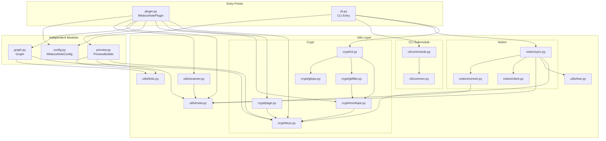
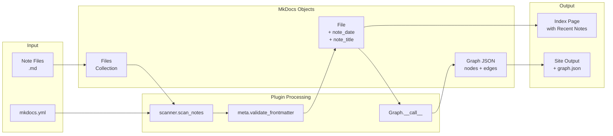
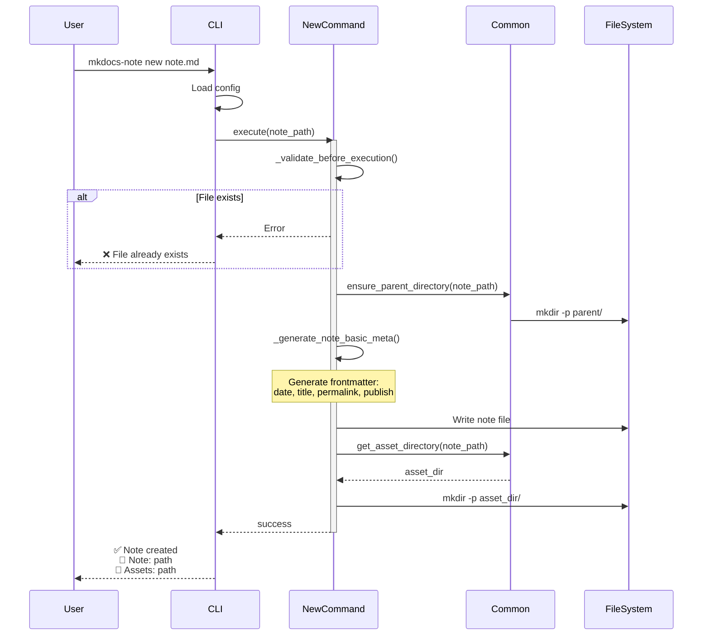
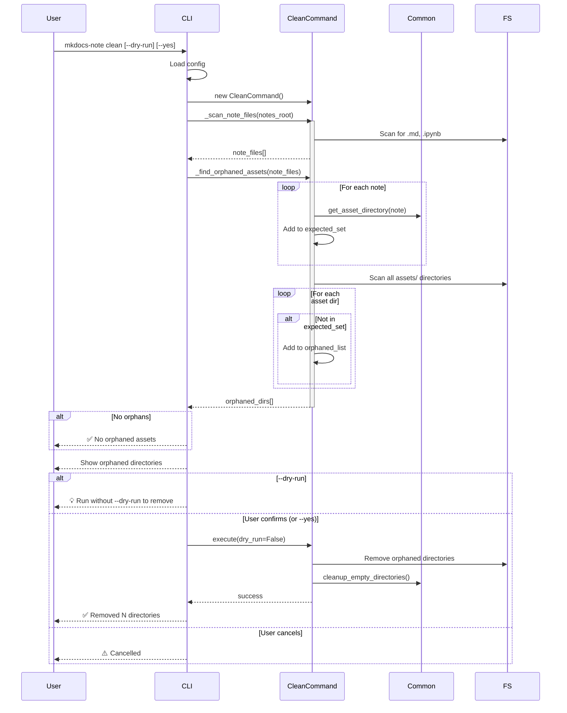
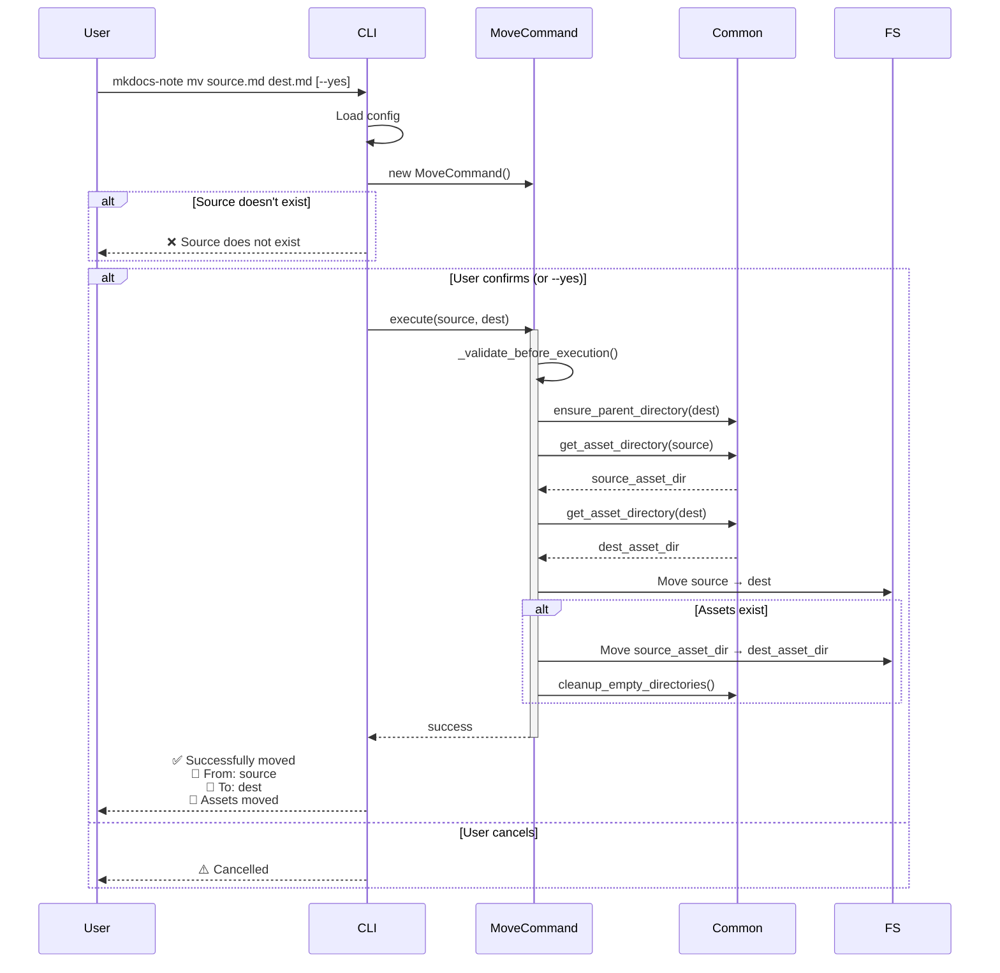

# Architecture Overview (v3.0.0+)

This document describes the complete architecture of the MkDocs-Note plugin in v3.0.0+, which adopts a simplified, lightweight design philosophy focused on core documentation needs.

---

## Project Overview

### Project Positioning

MkDocs Note is now a **lightweight documentation plugin** designed specifically for MkDocs and Material for MkDocs theme. It focuses on essential note management features with minimal complexity.

It just a simple python-based tool that help you manage your notes in MkDocs documentation site, why not make it simpler and concise?

### Core Design Philosophy

- **Simplicity First**: Minimal code, focused features, easy to understand and maintain

- **Co-located Resources**: Asset directories placed alongside note files following the pattern `note_file.parent / "assets" / note_file.stem`

- **Metadata-driven**: Simple frontmatter-based metadata (date, title, publish status)

- **MkDocs Integration**: Seamless integration with MkDocs ecosystem, leveraging existing infrastructure

---

## Architecture Evolution

### Architecture Timeline

| Version | Date | Philosophy | Code Size | Complexity |
|---------|------|------------|-----------|------------|
| v1.x | Early | Basic functionality | ~3,000 lines | Low |
| v2.0.0 | Oct, 2025 | Feature-rich, modular | ~12,000 lines | High |
| v3.0.0 | 2025-11-04 | Lightweight, simple | ~2,700 lines | Low |

### From v2.x to v3.0.0 (Major Simplification)

**v2.x Problems**:

- ❌ Over-engineered: Complex modular architecture (`assetps/`, `dataps/`, `docsps/`, `fileps/`, `graphps/`)

- ❌ Too many abstractions: 9,300+ lines of code, hard to maintain

- ❌ Feature creep: Template system, validation, initialization commands

- ❌ High maintenance burden: Many moving parts, potential bugs

**v3.0.0 Solutions** ([PR #60](https://github.com/virtualguard101/mkdocs-note/pull/60)):

- ✅ **Flat Structure**: Moved core modules to package root

- ✅ **Minimal Utils**: Only essential utilities (`meta.py`, `scanner.py`, `cli/`)

- ✅ **Removed Features**: Asset management system, template system, validation commands

- ✅ **Retained Core**: Recent notes, network graph, basic CLI commands

- ✅ **Code Reduction**: From ~12,000 to ~2,700 lines (77% reduction)

### Design Trade-offs

**What We Removed**:

- ❌ Asset management subsystem (`utils/assetps/`)

- ❌ Data models and frontmatter system (`utils/dataps/`)

- ❌ Document operations (creator, cleaner, mover, remover - `utils/docsps/`)

- ❌ File I/O abstraction layer (`utils/fileps/`)

- ❌ Advanced CLI commands (`init`, `validate`, `template`)

- ❌ Custom logging module

**What We Kept**:

- ✅ Recent notes display

- ✅ Network graph visualization

- ✅ Basic CLI: `new`, `remove`, `move`, `clean`

- ✅ Simple metadata extraction

---

## Simplified Architecture (v3.0.0+)

### Overall Structure Diagram

```
mkdocs-note/
├── src/mkdocs_note/
│   ├── __init__.py              # Package initialization
│   ├── __main__.py              # python -m mkdocs_note (used by the git filter)
│   ├── plugin.py                # MkDocs plugin entry point
│   ├── cli.py                   # Command-line interface entry point
│   ├── config.py                # Configuration management
│   ├── graph.py                 # Network graph functionality
│   ├── preview.py               # Same-site link hover preview
│   │
│   ├── static/                  # Static assets (graph + preview + encryption)
│   │   ├── graph.js
│   │   ├── graph.css
│   │   ├── preview.js
│   │   ├── preview.css
│   │   ├── encrypt.js           # WebCrypto unlock runtime
│   │   └── encrypt.css
│   │
│   └── utils/                   # Utility modules
│       ├── __init__.py
│       ├── meta.py              # Metadata / frontmatter (File + path APIs)
│       ├── links.py             # Shared markdown/wiki link normalization
│       ├── scanner.py           # File scanning (MkDocs Files)
│       ├── tree.py              # Page tree from .nav.yml or directory hierarchy
│       ├── crypt/               # Page encryption
│       │   ├── keys.py          # Password rules, HKDF/PBKDF2, AES-GCM seal/open
│       │   ├── envelope.py      # At-rest envelope build/parse, clean/smudge
│       │   ├── page.py          # Stub, browser payload, TOC HTML, leak audit
│       │   ├── gitfilter.py     # pkt-line long-running filter protocol
│       │   ├── gitops.py        # git subprocess helpers (config, index, HEAD)
│       │   └── cli.py           # crypt init/status/check/uninstall behavior
│       ├── notion/              # Notion sync (deprecated)
│       │   ├── convert.py       # Markdown → Notion Enhanced Markdown
│       │   ├── client.py        # Notion HTTP API
│       │   └── sync.py          # Orchestration (token, git diff, state, run_sync)
│       └── cli/                 # CLI command implementations
│           ├── __init__.py
│           ├── commands.py      # NewCommand, RemoveCommand, MoveCommand, CleanCommand
│           └── common.py        # Common utilities (asset paths, directory cleanup)
│
└── tests/                       # Test suite
```

### Module Responsibilities

| Module | Responsibility | Key Functions |
|--------|---------------|---------------|
| `plugin.py` | MkDocs plugin integration | File processing, recent notes, graph, link preview, encryption decrypt/encrypt hooks, leak audit |
| `cli.py` | CLI entry point | Command registration (`new`/`remove`/`move`/`clean`/`crypt`/`notion-sync`), mkdocs.yml load for sync |
| `config.py` | Configuration | Plugin settings (`notes_root`, `recent_notes_config`, `graph_config`, `preview_config`, `encryption_config`, `notion_sync`) |
| `graph.py` | Network graph | Node/edge creation, link detection, static asset management; skips out-edges of encrypted notes |
| `preview.py` | Link hover preview | `previews.json`, summary/excerpt extraction, gated static assets; skips encrypted pages and sources |
| `utils/links.py` | Link normalize | Shared markdown/wiki URL dialect for graph + preview |
| `utils/meta.py` | Metadata | Frontmatter validation (File), path-level parse / tags |
| `utils/scanner.py` | File scanning | Note file discovery and validation |
| `utils/tree.py` | Page tree | `.nav.yml` parse or `notes_root` directory hierarchy |
| `utils/crypt/` | Page encryption | Password rules + AES-GCM primitives, at-rest envelope, browser payload/stub/TOC, git filter protocol, git operations, `crypt` command behavior |
| `utils/notion/` | Notion sync (deprecated) | convert / client / sync (incl. `--full` resume under `.cache/mkdocs-note/`); skips encrypted notes |
| `utils/cli/commands.py` | CLI commands | `new`, `remove`, `move`, `clean` implementations |
| `utils/cli/common.py` | CLI utilities | Asset directory paths, directory cleanup |

### Dependency Diagram



---

## Core Modules Detail

### plugin.py - MkDocs Plugin Entry

**Responsibility**: MkDocs plugin integration and orchestration

**Key Components**:

```python
class MkdocsNotePlugin(BasePlugin[MkdocsNoteConfig]):
    """MkDocs Note Plugin entry point."""

    notes_list: list[File] = []

    # Event Hooks (value in brackets = event priority):
    def on_config(config)                  # Graph/preview assets; Notion deprecation notice
    def on_pre_build(config)               # Init Graph / PreviewBuilder if enabled
    def on_files(files, config) [100]      # Scan and validate notes
    def on_nav(nav, config, files)         # Store files reference
    def _on_page_markdown_decrypt(...) [100]   # Decrypt an at-rest envelope first
    def _on_page_markdown_recent(...)          # Insert recent notes (default priority)
    on_page_markdown = CombinedEvent(decrypt, recent)
    def on_page_content(...) [-1000]       # Replace encrypted page with stub + payload
    def on_post_page(output)               # Inject graph/preview/encrypt runtime assets
    def on_post_build(config)              # Build graph/previews JSON, copy assets, leak audit
```

`on_page_markdown` is a `mkdocs.plugins.CombinedEvent`: the decrypt handler runs
at priority 100 so every other plugin sees plaintext, while the recent-notes
handler keeps the default priority. `on_page_content` runs at -1000 so the
payload captures the final HTML after other plugins and site `hooks:` have run.
Both handlers live in the `CombinedEvent` / `on_page_content` sections below.

**Recent Notes Insertion**:
- Scans notes using `scanner.scan_notes()`
- Validates frontmatter with `meta.validate_frontmatter()`
- Sorts by `note_date` (extracted from frontmatter)
- Replaces marker with HTML list

### cli.py - Command Line Interface

**Responsibility**: Standalone CLI for note management

**Architecture**:
```python
@click.group()
def cli():
    """MkDocs Note CLI - Manage notes and their assets structure."""
    
# Commands:
@cli.command("new")      # Create new note
@cli.command("remove")   # Remove note (alias: rm)
@cli.command("move")     # Move/rename note (alias: mv)
@cli.command("clean")    # Clean orphaned assets
@cli.group("crypt")      # init / status / check / uninstall (+ hidden filter-process, clean, smudge)
@cli.command("notion-sync", deprecated=...)  # Deprecated since 3.5.0 (alias: ns)
```

**Key Features**:
- Custom command grouping (aliases shown together)
- Configuration loading from `mkdocs.yml` or defaults
- Rich feedback with emojis (✅ ❌ 📝 📁)
- Confirmation prompts (skip with `--yes`)
- Dry-run support for `clean` command
- `move -p` warns when the renamed permalink is an encrypted note's password
- `crypt` commands delegate to `utils.crypt.cli`; the filter commands write binary
  data to stdout and logs to stderr

### config.py - Configuration Management

**Responsibility**: Plugin configuration schema

**Configuration Options**:

```python
class MkdocsNoteConfig(Config):
	enabled: bool = True
	notes_root: Path = "docs"

	recent_notes_config: dict = {
		"enabled": False,
		"insert_marker": "<!-- recent_notes -->",
		"insert_num": 10,
	}

	graph_config: dict = {
		"enabled": False,
		"name": "title",  # or "file_name"
		"debug": False,
	}

	preview_config: dict = {
		"enabled": False,
		"mode": "summary",
		"delay_ms": 300,
		"max_chars": 200,
		"include_fragments": True,
		"mobile": False,
		"scope": "linked_only",
	}

	encryption_config: dict = {
		"kdf_iterations": 600000,
		"remember": "session",   # session | local | none
		"strict": "auto",        # auto = follow the CI environment variable
		"rerender": True,
		"audit": True,
		"labels": {},
	}
```

`Type(dict)` options do not merge nested defaults; the build reads every key
with `.get(key, default)`. The per-note `encrypt: true` frontmatter flag, not a
config option, is what enables encryption.

### graph.py - Network Graph Visualization

**Responsibility**: Generate and visualize note relationships

**Core Class**:

```python
class Graph:
    LINK_PATTERN = r"\[[^\]]+\]\((?P<url>.*?)\)|\[\[(?P<wikilink>[^\]]+)\]\]"
    
    def _create_nodes(files)         # Create nodes from documentation pages
    def _create_edges(files)         # Parse markdown for links; skip encrypted out-edges
    def _find_links(markdown)        # Extract links using regex (via utils.links)
    def to_dict()                    # Export graph data
```

Encrypted notes keep their node (the title is public) and edges pointing **to**
them, but their own out-edges are skipped so an encrypted body's links do not
leak through `graph.json`.

**Supporting Functions**:
- `add_static_resources()`: Add D3.js and custom JS/CSS to MkDocs config
- `inject_graph_script()`: Inject graph options into HTML
- `copy_static_assets()`: Copy graph.js and graph.css to site directory

### preview.py - Same-site Link Hover Preview

**Responsibility**: Build-time `previews.json` and gated preview assets ([issue #82](https://github.com/virtualguard101/mkdocs-note/issues/82))

**Core Class**:

```python
class PreviewBuilder:
    def __call__(files)              # Build url → {title, summary, …} mapping
    # linked_only inputs (refreshed in on_post_build):
    #   extra_src_paths / index_src_paths / graph_src_paths
```

**Supporting Functions**:
- `add_preview_static_resources()` / `copy_preview_static_assets()` / `inject_preview_script()` — only when `preview_config.enabled`
- Summary: frontmatter `description`/`summary` → first prose paragraph (skips `!!!`/`???`/`===`)
- Excerpt mode: hierarchical sections + fragment-aware plain text + sanitized HTML (`utils.links` + pymdownx slugify; decoded Unicode path + fragment keys)
  - Rich HTML via site Material `markdown_extensions` (skip `toc` / `pymdownx.snippets`) then allow-list sanitize
  - Image URL rewrite: MkDocs `Files` → directory-URL parent → source-parent map; absolute CDN/`data:` unchanged
- Pages with `encrypt: true` are skipped both as preview entries and as link
  sources, so a decrypted note's links and text never reach `previews.json`.

### utils/crypt/ - Page Encryption

**Responsibility**: Per-note symmetric encryption at rest and in the browser.
See the [user guide](../usage/encryption.md) for the workflow; this section
covers the implementation split.

| Module | Role |
|--------|------|
| `keys.py` | `is_encrypted`, `resolve_password` (`password` → `permalink`), NFC/trim normalization, HKDF-SHA256 at-rest key, PBKDF2-HMAC-SHA256 site key (memoized), synthetic-nonce AES-256-GCM `seal_at_rest` / `open_at_rest` / `seal_site` / `open_site` |
| `envelope.py` | Split frontmatter with MkDocs' `YAML_RE`; build/parse the `<!-- mkdocs-note:encrypted v1 key=… -->` envelope; `clean_bytes` / `smudge_bytes`; non-flagged input passes through byte-for-byte |
| `page.py` | Browser payload JSON (`v`, `iter`, `salt`, `iv`, `aad`, `ct`), locked/unavailable stub HTML, Material-markup TOC, asset injection/copy, plaintext canary collection and post-build leak audit |
| `gitfilter.py` | Git long-running filter protocol v2 (pkt-line handshake, `clean` / `smudge`); content on stdout, diagnostics on stderr |
| `gitops.py` | `git` subprocess helpers: repo root, git dir, hooks path, config get/set/unset, index and `HEAD` blobs |
| `cli.py` | `crypt init` / `status` / `check` / `uninstall` behavior and reports |

Key invariants:

- Only the **body** is encrypted. The frontmatter stays clear so MkDocs parses
  `page.meta` before our hooks run, and CI needs no key from outside the file.
- `clean_bytes` is deterministic for the same password/body, so `git status`
  stays stable; envelopes pass through `clean` unchanged.
- `smudge_bytes` never fails a checkout: an undecryptable envelope is emitted
  unchanged with one stderr warning.
- The at-rest KDF is deliberately fast (the password is in the same file); the
  site KDF is slow because a private repo may publish a public site.

### utils/links.py - Shared Link Normalization

**Responsibility**: One URL dialect for graph edges and preview keys (`normalize_link`, `iter_markdown_links`, `find_link_targets`)

**Link Detection**:
- Markdown links: `[text](url)`
- Wiki links: `[[page]]` / `[[page#heading]]`
- Handles URL escaping, query strings, fragments

### utils/meta.py - Metadata Extraction

**Responsibility**: Simple frontmatter validation and metadata extraction

**Key Functions**:

```python
def validate_frontmatter(f: File) -> bool:
	"""Validate frontmatter, extract date and title.

	Required fields:
	- date: datetime object
	- title: string
	- publish: bool (default True)

	Side effects: Sets f.note_date and f.note_title
	"""


def extract_date(f: File) -> Optional[datetime]:
	"""Extract date from validated file."""


def extract_title(f: File) -> Optional[str]:
	"""Extract title from validated file."""
```

**Validation Rules**:
- ❌ Skip if `publish: false`
- ❌ Error if missing `date` or `title`
- ❌ Error if wrong type
- ✅ Store metadata as file attributes

### utils/scanner.py - File Scanning

**Responsibility**: Scan and filter note files

**Key Function**:

```python
def scan_notes(files: Files, config) -> tuple[list[File], list[File]]:
	"""Scan notes directory, return (valid_notes, invalid_files).

	Filtering:
	1. Only documentation pages (is_documentation_page())
	2. Within notes_root directory
	3. Valid frontmatter (validate_frontmatter())

	Returns:
	    (valid_notes, invalid_files)
	"""
```

**MkDocs Integration**:
- Uses `mkdocs.structure.files.Files`
- Leverages `is_documentation_page()` for file type filtering
- Works with MkDocs' path resolution

### utils/cli/commands.py - CLI Command Implementations

**Command Classes**:

| Class | Responsibility | Key Methods |
|-------|---------------|-------------|
| `NewCommand` | Create new note | `_generate_note_basic_meta()`, `execute()` |
| `RemoveCommand` | Remove note and assets | `_remove_single_document()`, `_remove_docs_directory()` |
| `MoveCommand` | Move/rename note and assets | `_move_single_document()`, `_move_docs_directory()` |
| `CleanCommand` | Clean orphaned assets | `_scan_note_files()`, `_find_orphaned_assets()` |

**Common Pattern**:
```python
class XxxCommand:
    def _validate_before_execution() -> int
        # Returns 0 (fail), 1 (single file), 2 (directory)
    
    def execute(path) -> None
        # Main execution logic
```

### utils/cli/common.py - CLI Utilities

**Utility Functions**:

```python
def get_asset_directory(note_path: Path) -> Path:
	"""Co-located asset structure: note.parent / 'assets' / note.stem"""
	return note_path.parent / "assets" / note_path.stem


def cleanup_empty_directories(start_dir: Path, stop_at: Path):
	"""Recursively remove empty parent directories."""


def ensure_parent_directory(path: Path):
	"""Create parent directory if needed."""
```

**Asset Directory Pattern**:
```
docs/notes/python/intro.md
                 └─ assets/intro/  (asset directory)
```

---

## Data Models (Simplified)

### Core Data Structure

In v3.0.0+, we **leverage MkDocs' existing data structures** instead of creating custom models:

**Primary Data Object**: `mkdocs.structure.files.File`

```python
# MkDocs File object (extended by plugin)
class File:
	src_path: str  # Source path relative to docs_dir
	abs_src_path: str  # Absolute source path
	url: str  # URL path for the file
	content_string: str  # File content
	page: Optional[Page]  # Associated Page object

	# Plugin-added attributes (via setattr):
	note_date: datetime  # From frontmatter
	note_title: str  # From frontmatter
```

### Frontmatter Schema

**Minimal Required Fields**:

```yaml
---
date: 2025-11-05 12:00:00    # datetime (required)
title: My Note Title         # string (required)
permalink:                   # string (optional; default encryption password)
publish: true                # bool (default: true)
encrypt: false               # bool (default: false)
# password: "custom secret"  # string (optional; overrides permalink)
---
```

**Processed by MkDocs**:
- Uses `mkdocs.utils.meta.get_data()` for parsing
- YAML frontmatter automatically converted to Python types
- `date` becomes `datetime` object

**Encryption fields** are read from `page.meta` by both the build hooks and the
git filter. `encrypt: true` requires a non-empty `password` or `permalink`;
values are normalized with Unicode NFC + `strip()` in Python and JavaScript so
the same typed password derives the same key everywhere.

### Graph Data Model

**Graph JSON Structure**:

```json
{
  "nodes": [
    {
      "id": "notes/python/intro.md",
      "path": "/abs/path/to/notes/python/intro.md",
      "name": "Python Introduction",
      "url": "notes/python/intro/"
    }
  ],
  "edges": [
    {
      "source": "notes/python/intro.md",
      "target": "notes/python/basics.md"
    }
  ]
}
```

### Data Flow Diagram



### Encryption Data Flow

```mermaid
graph LR
    subgraph "Author clone"
        WT["note.md<br/>plaintext worktree"]
        Filter["git clean / smudge<br/>mkdocs-note crypt filter-process"]
    end

    subgraph "Git repository (public)"
        Envelope["envelope<br/>clear frontmatter<br/>+ encrypted body"]
    end

    subgraph "mkdocs build (local or CI, workflow unchanged)"
        Decrypt["on_page_markdown @100<br/>decrypt body with page.meta password"]
        Render["MkDocs + other plugins<br/>render the page"]
        Encrypt["on_page_content @-1000<br/>AES-GCM payload + TOC"]
        Stub["stub HTML<br/>lock form + payload JSON"]
    end

    subgraph "Published site"
        Page["page.html"]
        JS["encrypt.js<br/>PBKDF2 + AES-GCM via WebCrypto"]
        Reader["unlocked content"]
    end

    WT -- "git add (clean)" --> Filter
    Filter -- "git checkout (smudge)" --> WT
    Filter --> Envelope
    Envelope --> Decrypt
    Decrypt --> Render
    Render --> Encrypt
    Encrypt --> Stub
    Stub --> Page
    Page --> JS
    JS --> Reader
```



The layer keys are independent:

| Layer | Key derivation | Cipher | Why |
|-------|---------------|--------|-----|
| At rest (git) | `HKDF-SHA256(password)` — fast | AES-256-GCM, synthetic nonce `HMAC-SHA256(K_nonce, aad ‖ 0x00 ‖ body)` | The password sits in the same file, so a slow KDF protects nothing; determinism keeps `git status` stable |
| Site (browser) | `PBKDF2-HMAC-SHA256(password, salt=SHA-256("…" + src_uri)[:16], 600k)` | AES-256-GCM, same synthetic-nonce construction | A private repo may publish a public site; the slow KDF matters there, and a stable per-page salt keeps remembered keys valid across deploys |

AAD binds each ciphertext to its context: the key field for envelopes, the
`src_uri` for site payloads.

---

## Workflows and Data Flow

### Plugin Build-time Workflow (v3.0.0+)

```mermaid
sequenceDiagram
    participant MkDocs
    participant Plugin
    participant Scanner
    participant Meta
    participant Graph
    participant Preview
    participant Crypt as utils.crypt
    
    MkDocs->>Plugin: on_config(config)
    Plugin->>Plugin: Add graph static resources
    alt preview_config.enabled
        Plugin->>Plugin: Add preview.js/css
    end
    Plugin-->>MkDocs: config
    
    MkDocs->>Plugin: on_pre_build(config)
    alt graph enabled
        Plugin->>Graph: new Graph(config)
    end
    alt preview enabled
        Plugin->>Preview: new PreviewBuilder(config)
    end
    Plugin-->>MkDocs: void
    
    MkDocs->>Plugin: on_files(files, config)
    activate Plugin
    
    Plugin->>Scanner: scan_notes(files, config)
    activate Scanner
    
    loop For each file in files
        Scanner->>Scanner: Check if in notes_root
        Scanner->>Meta: validate_frontmatter(file)
        Meta->>Meta: Check publish, date, title
        Meta->>Meta: setattr(file, 'note_date', date)
        Meta->>Meta: setattr(file, 'note_title', title)
        Meta-->>Scanner: valid/invalid
    end
    
    Scanner-->>Plugin: (valid_notes[], invalid_files[])
    deactivate Scanner
    
    Plugin->>Plugin: Sort notes by note_date
    Plugin->>Plugin: Remove invalid files from files
    Plugin-->>MkDocs: files
    deactivate Plugin
    
    MkDocs->>Plugin: on_nav(nav, config, files)
    Plugin->>Plugin: Store files reference
    Plugin-->>MkDocs: nav
    
    loop For each page
        MkDocs->>Plugin: on_page_markdown(markdown, page)
        
        alt page.meta encrypt: true
            Plugin->>Crypt: resolve_password(meta)
            Plugin->>Crypt: decrypt_body(markdown, meta)
            alt undecryptable and strict
                Plugin-->>MkDocs: PluginError
            else undecryptable, non-strict
                Plugin->>Plugin: remember error; return empty body
            end
            Plugin->>Plugin: collect leak canaries
        end

        alt Is index page in notes_root
            Plugin->>Plugin: insert_recent_note_links()
            Plugin->>Plugin: Replace marker with HTML list
        end
        
        Plugin-->>MkDocs: markdown
    end

    Note over MkDocs,Plugin: Markdown rendered, other plugins run

    loop For each page
        MkDocs->>Plugin: on_page_content(html, page) [-1000]
        alt page.meta encrypt: true and decryption succeeded
            Plugin->>Crypt: build_toc_html(page.toc)
            Plugin->>Crypt: build_site_payload(content, toc, password)
            Plugin->>Plugin: page.toc = empty TableOfContents
            Plugin-->>MkDocs: build_stub(title, payload)
        else previously failed to decrypt
            Plugin-->>MkDocs: build_unavailable_stub()
        end
    end
    
    loop For each page
        MkDocs->>Plugin: on_post_page(output, page)
        Plugin->>Plugin: inject_graph_script(output)
        alt preview enabled
            Plugin->>Plugin: inject_preview_script(output)
        end
        alt encrypted page
            Plugin->>Plugin: inject_encrypt_assets(output)
        end
        Plugin-->>MkDocs: output
    end
    
    MkDocs->>Plugin: on_post_build(config)
    
    alt Graph enabled
        Plugin->>Graph: __call__(files)
        Graph->>Graph: _create_nodes(files)
        Graph->>Graph: _create_edges(files) — skip encrypted out-edges
        Plugin->>Plugin: Write graph.json
    end

    alt Preview enabled
        Plugin->>Preview: __call__(files)
        Plugin->>Plugin: Write previews/previews.json
        Plugin->>Plugin: copy preview.js/css
    end

    alt Any encrypted page seen
        Plugin->>Plugin: copy encrypt.js/css
        Plugin->>Crypt: audit_plaintext_leaks(site_dir, canaries)
    end
    
    Plugin->>Plugin: copy_static_assets()
    Plugin-->>MkDocs: void
```

### CLI Command Workflows (v3.0.0+)

#### new Command (Note Creation)



#### clean Command (Orphaned Asset Cleanup)



#### move Command (Note Move/Rename)



---

## Design Principles (v3.0.0+)

### Simplicity First

**Core Philosophy**: Minimal complexity, maximum clarity

- ✅ **Flat Structure**: Core modules at package root, not buried in nested subpackages

- ✅ **Direct Dependencies**: Minimize abstraction layers

- ✅ **Standard Library**: Prefer Python/MkDocs built-ins over custom solutions

- ✅ **Code Minimalism**: ~2,700 lines vs. ~12,000 lines in v2.x

**Example**:
```python
# v3.0.0: Direct, simple
from mkdocs.utils import meta

frontmatter, body = meta.get_data(content)

# v2.x: Over-abstracted
from mkdocs_note.utils.dataps.frontmatter.handlers import FrontmatterParser

parser = FrontmatterParser()
frontmatter, body = parser.parse(content)
```

### Leverage MkDocs Infrastructure

**Principle**: Don't reinvent what MkDocs provides

- ✅ **Use MkDocs File objects**: Extend with `setattr()` instead of custom wrappers

- ✅ **Use MkDocs logging**: `get_plugin_logger(__name__)` instead of custom logger

- ✅ **Use MkDocs meta parsing**: `mkdocs.utils.meta.get_data()` for frontmatter

- ✅ **Follow MkDocs conventions**: Plugin hooks, configuration schema

**Benefits**:
- Better compatibility with MkDocs ecosystem
- Less maintenance burden
- Familiar API for MkDocs developers

### Co-located Resources

**Pattern**: Assets live next to their notes

```
docs/notes/python/intro.md
                └─ assets/intro/  (assets for intro.md)
```

**Implementation**:
```python
def get_asset_directory(note_path: Path) -> Path:
	return note_path.parent / "assets" / note_path.stem
```

**Advantages**:

- ✅ Easy to understand and manage

- ✅ Move note → assets move with it (CLI commands handle this)

- ✅ No complex path calculations

- ✅ Intuitive for users

### Fail Fast, Fail Clear

**Principle**: Clear error messages, early validation

```python
# Frontmatter validation
if not frontmatter.get("publish", False):
	logger.debug(f"Skipping {f.src_uri} because it is not published")
	return False

if "date" not in frontmatter:
	logger.error(f"Invalid frontmatter for {f.src_uri}: 'date' is required")
	return False
```

**CLI Error Handling**:
```python
if not note_path.exists():
	click.echo(f"❌ Error: File does not exist: {note_path}", err=True)
	sys.exit(1)
```

### Testing Strategy

**Test Coverage**:

- ✅ Plugin tests: Core MkDocs integration

- ✅ CLI tests: Command execution, argument parsing

- ✅ Smoke tests: End-to-end workflows

- ✅ Config tests: Configuration validation

**Testing Principles**:

- Use temporary directories for file operations

- Test both success and failure paths

- Clear, descriptive test names

- Minimal test fixtures

---

## Key Technical Decisions (v3.0.0+)

### Why Simplify from v2.x to v3.0.0?

**Problem Statement**: v2.x was over-engineered for the actual use cases

**v2.x Issues**:

- ❌ **Complexity**: 9+ subpackages, 12,000+ lines of code

- ❌ **Maintenance Burden**: Many abstractions, hard to debug

- ❌ **Feature Creep**: Template system, validation, initialization - rarely used

- ❌ **Learning Curve**: New contributors struggled to understand architecture

**v3.0.0 Solution**:

- ✅ **Radical Simplification**: Removed 77% of code

- ✅ **Focus on Core**: Kept only essential features (recent notes, graph, basic CLI)

- ✅ **Flat Structure**: Easy to navigate and understand

- ✅ **Better Integration**: Leverage MkDocs infrastructure instead of reimplementing

**Result**:

- Faster build times

- Easier to maintain

- Clearer purpose

- Better reliability

### Why Keep Co-located Asset Structure?

**Decision**: Retain co-located pattern from v2.x

```
docs/notes/python/intro.md
                └─ assets/intro/  (co-located)
```

**Rationale**:

- ✅ **User-friendly**: Easy to understand and manage

- ✅ **Portable**: Move note → assets move with it

- ✅ **Simple**: One function, one rule

- ✅ **Proven**: Worked well in v2.x

**Implementation**:
```python
# Single source of truth
def get_asset_directory(note_path: Path) -> Path:
	return note_path.parent / "assets" / note_path.stem
```

### Why Use MkDocs' Built-in Frontmatter Parsing?

**Decision**: Use `mkdocs.utils.meta.get_data()` instead of custom parser

**Rationale**:

- ✅ **Standard**: MkDocs already has YAML frontmatter support

- ✅ **Type Conversion**: Automatic conversion (dates, booleans)

- ✅ **Well-tested**: Proven by MkDocs ecosystem

- ✅ **Less Code**: No need to maintain custom parser

**Comparison**:
```python
# v2.x: Custom parser (~200 lines)
from mkdocs_note.utils.dataps.frontmatter.handlers import FrontmatterParser

parser = FrontmatterParser()
fm, body = parser.parse_file(path)

# v3.0.0: Built-in (~5 lines)
from mkdocs.utils import meta

with open(path) as f:
	fm, body = meta.get_data(f.read())
```

### Why Remove Template System?

**Decision**: Remove template system with variable substitution

**v2.x Template System**:

- Template files with `{date}`, `{title}` placeholders

- Complex variable replacement logic

- Template registry and loading mechanism

**Why Remove**:

- ❌ **Low Usage**: Most users used default template

- ❌ **Complexity**: ~500 lines of code for rare feature

- ❌ **Maintenance**: Breaking changes when frontmatter changed

**v3.0.0 Approach**:
```python
# Simple, direct frontmatter generation
def _generate_note_basic_meta(self, file_path: Path) -> str:
	return f"""---
date: {datetime.now().strftime("%Y-%m-%d %H:%M:%S")}
title: {file_path.stem.replace("-", " ").title()}
permalink: 
publish: true
---
"""
```

**Benefits**:

- ✅ **Maintainable**: 10 lines vs. 500 lines

- ✅ **Flexible**: Users can edit after creation

### Why Keep Network Graph?

**Decision**: Retain graph visualization despite simplification

**Rationale**:
- ✅ **Self-contained**: `graph.py` / `preview.py` are independent modules; shared link logic lives in `utils/links.py`

- ✅ **Migrated Code**: Already ported from mkdocs-network-graph-plugin

- ✅ **Low Maintenance**: Stable, minimal dependencies

**Integration**:

- Uses D3.js for rendering (CDN)

- Generates `graph.json` with nodes and edges

- Injects JavaScript configuration via HTML hook

### Why Not `on_page_read_source` for Decryption?

**Decision**: Decrypt in `on_page_markdown` via a `CombinedEvent` at priority 100.

`on_page_read_source` would run earlier, but it is deprecated in MkDocs 1.6, and
replacing `File.content_string` nulls `abs_src_path`. The scanner, graph,
preview builder and git-revision-date plugin all read that path. Decrypting in
`on_page_markdown` keeps every other consumer working and still runs before any
other plugin that transforms Markdown.

### Why Encrypt Only the Body?

**Decision**: The envelope leaves the original YAML frontmatter in clear text
and encrypts only everything after it.

- MkDocs parses `page.meta` before plugin hooks, so the password is available
  from the same file even in a fresh CI checkout with no filter.
- The scanner can read `date`/`title`/`publish` without a key, which keeps
  titles in nav, recent notes and the graph (a locked decision).
- Frontmatter edits produce readable diffs; only the body diff is opaque.
- The frontmatter is public by design, so its contents were never the secret.

### Why a Fast At-rest KDF but a Slow Site KDF?

**Decision**: HKDF-SHA256 for git envelopes; PBKDF2-HMAC-SHA256 with 600k
iterations for browser payloads.

The at-rest password is stored in the same envelope's frontmatter, so an
attacker with the repository already has it — a slow KDF would only make every
`git add` and checkout slower. The site payload is different: in a private
repository the frontmatter is not public, and a leaked `page.html` would turn a
fast KDF into an offline guessing oracle. The browser can afford the slow KDF
once per page, and results are memoized per process during `mkdocs serve`.

### Why `document$.next(document)` After Unlocking?

**Decision**: Optionally re-run Material's observable after the stub is
replaced (`encryption_config.rerender`, default on).

Decrypted HTML was never seen by Material's initializer, so code-copy buttons,
tabs, tooltips, Mermaid and MathJax would not bind. `document$.next(document)`
re-mounts those components and also re-runs site `hooks:` subscribers such as
custom math/link scripts. A `mkdocs-note:decrypted` CustomEvent is dispatched
for integrations that need a precise signal. Inline `<script>` in decrypted
content still does not execute, which is documented as a limitation.

---

## Migration Guide

### Migrating from v2.x to v3.0.0

!!! warning "Breaking Changes"
    `v3.0.0` removes many features from `v2.x`.
    Please review the [changelog](../about/changelog.md#300---2025-11-04-Architecture-Simplification) before upgrading.

#### Step 1: Review Removed Features

**No longer available in v3.0.0**:

- ❌ Template system (`notes_template` config)

- ❌ Asset management system

- ❌ `init` and `validate` CLI commands

- ❌ Custom frontmatter registry

- ❌ `assets_dir` configuration option

**Still available**:

- ✅ Recent notes display

- ✅ Network graph visualization

- ✅ Basic CLI: `new`, `remove`, `move`, `clean`

- ✅ Frontmatter metadata (`date`, `title`, `publish`, `permalink`)

#### Step 2: Update Configuration

**Old (v2.x) config**:
```yaml
plugins:
  - mkdocs-note:
      notes_root: "docs/notes"
      assets_dir: "docs/notes/assets"  # ❌ Removed
      notes_template: "template.md"    # ❌ Removed
      recent_notes_config:
        enabled: true
        insert_num: 10
```

**New (v3.0.0) config**:
```yaml
plugins:
  - mkdocs-note:
      notes_root: "docs/notes"  # ✅ Still supported
      recent_notes_config:      # ✅ Still supported
        enabled: true
        insert_num: 10
      graph_config:             # ✅ Enhanced
        enabled: true
        name: "title"
```

#### Step 3: Update Frontmatter (if needed)

**v3.0.0 requires** these fields:
```yaml
---
date: 2025-11-05 12:00:00  # Required: datetime
title: My Note              # Required: string
publish: true               # Optional: bool (default: true)
permalink:                  # Optional: string
---
```

Notes without valid frontmatter will be **excluded** from builds.

#### Step 4: Test Your Build

```bash
# Clean previous builds
rm -rf site/

# Build with v3.0.0
mkdocs build

# Check for errors
# - Missing frontmatter errors
# - Invalid date/title errors
```

### For Plugin Developers

**Module path changes**:

```python
# v2.x: Complex paths
from mkdocs_note.utils.dataps.meta import NoteInfo
from mkdocs_note.utils.docsps.handlers import NoteProcessor
from mkdocs_note.utils.dataps.frontmatter.handlers import FrontmatterManager

# v3.0.0: Simplified (or don't import internals)
# Most internal APIs are NOT intended for external use
# Use plugin configuration instead
```

**Recommendation**: Don't depend on internal APIs. Use:
- Plugin configuration (`mkdocs.yml`)
- CLI commands
- Frontmatter metadata

---

## References

### External Resources

- [MkDocs Documentation](https://www.mkdocs.org/)

- [Material for MkDocs](https://squidfunk.github.io/mkdocs-material/)

- [MkDocs Network Graph Plugin](https://github.com/develmusa/mkdocs-network-graph-plugin) (graph.py origin)

- [Keep a Changelog](https://keepachangelog.com/)

- [Semantic Versioning](https://semver.org/)

### Design Philosophy References

- [YAGNI (You Aren't Gonna Need It)](https://en.wikipedia.org/wiki/You_aren%27t_gonna_need_it)

- [KISS (Keep It Simple, Stupid)](https://en.wikipedia.org/wiki/KISS_principle)

- [The Zen of Python](https://peps.python.org/pep-0020/) ("Simple is better than complex")

---
